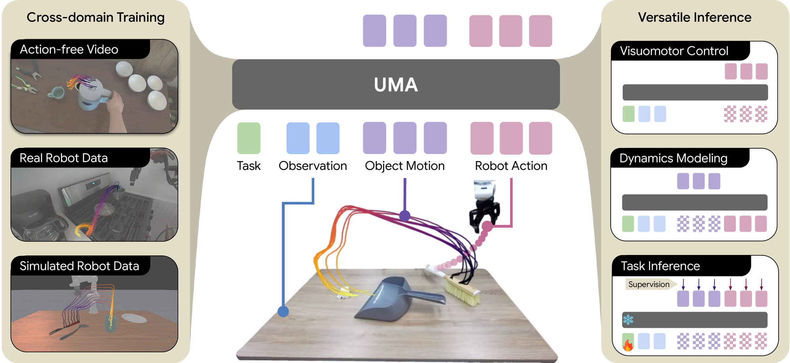

# UMA: Unified Motion-Action Modeling for Heterogeneous Robot Learning

**CoRL 2026**

[Yunhao Cao](https://www.quantumcookie.xyz/)\*, Shitong Liu\*, [Chao Feng](https://cfeng16.github.io/)\*, Meryl Zhang,
[Xuanchen Lu](https://xuanchenlu.com/), [Andrew Owens](https://andrewowens.com/), [Kuan Fang](https://kuanfang.github.io/)

Cornell University &nbsp;&middot;&nbsp; \* equal contribution

[**Website**](https://uma-manipulation.github.io) &nbsp;|&nbsp; [**Paper**](https://arxiv.org/abs/2606.16917) &nbsp;|&nbsp;
[**Checkpoints**](https://huggingface.co/quantumcookie/UMA) &nbsp;|&nbsp; [**BibTeX**](#citation)



UMA is a single transformer that models how objects move (3D point flow) and how the robot acts (end-effector
actions) with one masked flow-matching objective. Because object motion is shared between robots and people, UMA is
pretrained on a mix of simulated robot data, real robot data and human videos (which have flow but no actions), and
then fine-tuned for a robot and its tasks. At test time it is conditioned on a *motion prompt*: the desired 3D
trajectory of a few points on the object to move, or on a language instruction.

> **Release status.** This release contains the model and inference code. The simulation evaluation code is being
> cleaned up and will be released in the coming weeks.

## Installation

Python 3.10+. Install [PyTorch](https://pytorch.org/get-started/locally/) for your CUDA version first, then:

```bash
git clone https://github.com/realquantumcookie/UMA.git
cd UMA
pip install -e ".[examples]"
```

The vision-language encoder ([SigLIP 2](https://huggingface.co/google/siglip2-base-patch16-224)) is downloaded from
Hugging Face on first use.

## Checkpoints

| Checkpoint | Description |
| --- | --- |
| [`quantumcookie/UMA` / `uma_pretrain.pt`](https://huggingface.co/quantumcookie/UMA) | Pretrained on simulation, real robot and human-video data (EMA weights, 523 MB) |

`load_model()` downloads it on first use (cached by `huggingface_hub`); pass a file path to load your own checkpoint.

## Forward pass

`examples/forward_pass.py` runs UMA on one recorded observation from a simulated insertion episode
(`examples/sample_insertion.npz`) and prints the predicted actions:

```bash
python examples/forward_pass.py --plot prediction.png
```

In your own code:

```python
from uma.inference import UMAObservation, load_model, predict, proprioception_from_pose

model = load_model(device="cuda")  # pretrained checkpoint, downloaded on first use; or load_model("/path/to/uma.pt")

observation = UMAObservation(
    rgb=rgb,                    # (B, H, W, 3) uint8, exterior camera
    depth=depth,                # (B, H, W) metres
    intrinsics=K,               # (B, 3, 3)
    extrinsics=T_cam_base,      # (B, 3, 4) robot base -> camera
    proprioception=proprioception_from_pose(eef_pos, eef_quat_wxyz, gripper),  # (B, 8, 10), last 8 steps
    tracked_points=tracked,     # (B, 8, M, 5): xyz (robot base), visible, valid; last 8 steps
    wrist_rgb=wrist_rgb,        # optional (B, H, W, 3) uint8
).to("cuda")

# Condition on a motion prompt ...
out = predict(model, observation, motion_prompt, seed=0)  # motion_prompt: (B, T, N, 4) xyz + valid
# ... or on a language instruction (one string, or one per batch element)
out = predict(model, observation, language="put the spatula into the utensil holder", seed=0)

out["actions"]        # (B, 8, 10): end-effector position, 6D rotation, gripper (robot base frame)
out["future_points"]  # (B, 19, M, 3): predicted positions of the tracked points
```

The policy takes one task description at a time: a motion prompt or a language instruction. During pretraining,
an example that had both was conditioned on one of them at random. With the example script, `--language "..."` replaces the sample's
motion prompt with an instruction.

Conventions:

- **Frames.** 3D inputs and outputs are in the robot-base frame; `extrinsics` maps robot-base points into the camera
  frame (`x_cam = R x_base + t`).
- **Proprioception and actions** are 10-D: end-effector position (m), its rotation as the first two rows of the
  rotation matrix, and the gripper (`0` open, `1` closed). Actions are absolute end-effector targets for the next
  steps at 15 Hz.
- **History.** The model uses the last 8 control steps of proprioception and tracked points (oldest first);
  `future_points` covers the next 16 steps and the far-future steps 32, 64 and 128.
- **Tracked points** need not be the prompt's points. During training they were a random subset of points on the
  scene (1 to 16, moving or not), picked independently of the prompt. So they can come from a point tracker following
  the prompt's points (as in the example), or be any points sampled on the scene, which the model then tracks
  implicitly through its flow prediction. Implicit tracking is easier to set up but costs some performance.
- **Motion prompt.** `(T, N, 4)` positions of `N` points over `T` steps (2 to 16), plus a validity flag, describing
  the whole desired motion from where the points were when the prompt was given. Pass that moment's camera frame as
  `prompt_rgb` / `prompt_depth` (by default the current frame is used). The example's prompt has 24 points: 16 on
  the spatula and 8 on the scene, which stay put.

The model configuration is `uma/configs/uma.yaml`.

## UniEnv policy

`uma.unienv_policy.UMAPolicy` wraps the model as a [UniEnv](https://github.com/UniEnvOrg/UniEnv) `Policy`, so it
runs in a closed loop with any UniEnv environment. It keeps the 8-step observation history, predicts an action chunk,
executes it one step at a time and re-plans when the chunk is used up (`execute_horizon`, 8 by default):

```python
from uma.inference import load_model
from uma.unienv_policy import UMAPolicy

policy = UMAPolicy(load_model(), batch_size=1, image_size=(224, 224), num_tracked_points=24,
                   conditioning="motion_prompt")   # or conditioning="language"
policy.reset(context, observation)                  # context: {"motion_prompt": (B, T, N, 4)} or {"language": [...]}
while not done:
    action = policy.get_action()                    # (B, 10) end-effector target, valid for policy.action_space
    observation, reward, terminated, truncated, info = env.step(action)
    policy.observe_transition(action, observation, dt)
```

`policy.observation_space`, `policy.context_space` and `policy.action_space` describe the expected data: the view
camera's `rgb` / `depth` / `intrinsics` / `extrinsics`, `eef_position`, `eef_quaternion_wxyz`, `gripper`,
`tracked_points` (`(B, M, 5)`, current step only) and optionally `wrist_rgb`, all in the conventions above. Batched
environments can restart some sub-environments with `policy.reset(context, observation, mask=done)`. The policy
expects a 15 Hz control rate.

## Citation

```bibtex
@inproceedings{cao2026uma,
  title={Unified Motion-Action Modeling for Heterogeneous Robot Learning},
  author={Yunhao Cao and Shitong Liu and Chao Feng and Meryl Zhang and Xuanchen Lu and Andrew Owens and Kuan Fang},
  booktitle={Conference on Robot Learning (CoRL)},
  year={2026},
}
```

## License

MIT (see `LICENSE`).
